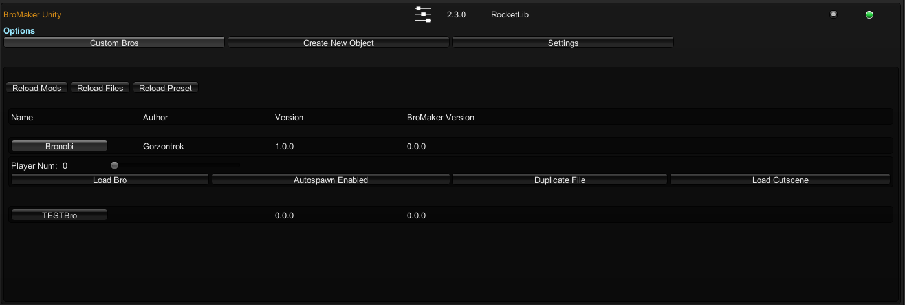
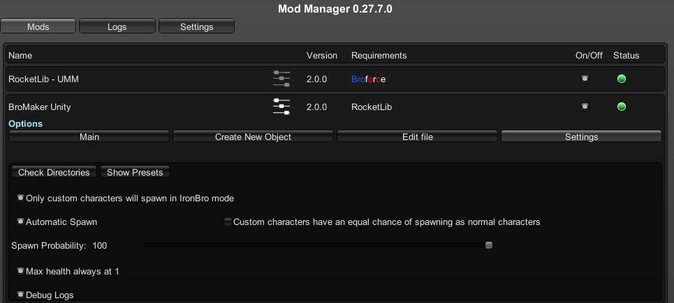

# Bro Maker

 This mod allows you to make custom Bros for Broforce.

 Thanks to alexneargarder who laid the groundwork for custom bros.

 If you find an issue, please inform me.

## Installation

* All of my mods require [Unity Mod Manager](https://thunderstore.io/c/broforce/p/UMM/UMM/) (install via [r2modman](https://thunderstore.io/c/broforce/p/ebkr/r2modman/)).
* Also requires [RocketLib](https://thunderstore.io/c/broforce/p/RocketLib/RocketLib/)
* The installation guide can be found [here](https://steamcommunity.com/sharedfiles/filedetails/?id=2434812447).  
* The latest Release is in the `/Release/` folder.

* To install custom bros, unzip the archive in `Broforce/BroMaker_Storage/`

## Known Issues

* 当前开发分支已接入 RocketLib 公共联机层，并有双端有限验证。角色专属机制仍须作者适配，不能将全部自定义角色视为已支持联机；既有 Release 包也不代表包含当前开发改动。

## How to Spawn as a Custom Bro

In order to spawn with a Custom Bro you need to install one.

Once you are in a level, open the menu of BroMaker and click on the name of a bro, and click Switch to Bro.

You can also set the mod to have a chance for you to automatically spawn as a custom bro.

## Guide for Developers

[联机接入与作者责任](docs/networking.md)：公共角色/投射物生成、拥有端调用方式、专属事件与伤害边界。主线不再逐个迁移消费者。

[Wiki](https://github.com/Gorzontrok/Bro-Maker/wiki)
